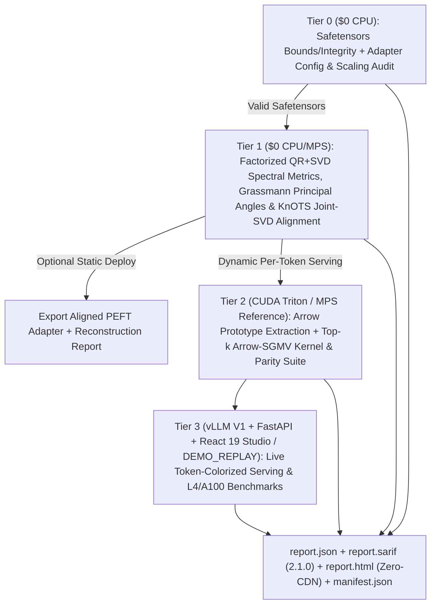

# Stage 1: Business Requirements Document (BRD) — `loraspec`

> [!NOTE]
> **Document Status**: Locked (Stage 1)
> **Product Identity**: **`loraspec`** — LoRA Subspace Auditor (`KnOTS`) & Per-Token Top-$k$ `MoLoRA` Triton Studio
> **Charter Reference**: [00-CHARTER.md](./00-CHARTER.md)
> **Research Basis**: [RESEARCH-DOSSIER.md](./RESEARCH-DOSSIER.md)
> **Stage 2 FRD / PRD**: [02-FRD-PRD.md](./02-FRD-PRD.md)
> **Requirement Traceability Prefix**: `BRD-REQ-01` through `BRD-REQ-22` (mapped 100% into `FRD-REQ-*`, `FEAT-*`, `ARCH-COMP-*`, `SDD-*`, and `05-IMPLEMENTATION-PLAN.md`).

---

## 1. Executive Summary & Business Problem Statement

Modern AI engineering teams increasingly train **multiple lightweight LoRA adapters** ($r \in \{8, 16, 32, 64\}$) over a single open-weight backbone (`Qwen2.5-3B`, `Qwen3-4B`, `Llama-3.1-8B`) to replace expensive `$10+/1M` closed frontier APIs with fast, specialized `$0.18/1M` serving stacks. However, moving from one LoRA to a **multi-LoRA fleet** triggers three compounding engineering and business failures:

1. **Silent Subspace Destruction During Static Merging**: Teams invoke `peft` `linear`, `TIES`, or `DARE` merges blindly. Because independently trained LoRAs possess misaligned singular bases ($B_m A_m$), opposing parameter signs and overlapping principal directions collide—degrading downstream accuracy by 5–20+ percentage points with zero pre-merge diagnostic warning.
2. **Undetected Rank Collapse & Spectral Instability**: Teams deploy rank-32 or rank-64 adapters whose effective stable rank ($r_{\text{eff}} = \|\Delta W\|_F^2 / \|\Delta W\|_2^2$) has collapsed to $1.1$–$2.0$, or whose spectral norms $\|\Delta W\|_2$ spike 10× above peer layers—burning VRAM bandwidth or destabilizing merged logits without automated CI checks.
3. **The Per-Sequence vs. Unbatched Dynamic Serving Gap**:
   - `vLLM V1`'s Punica `SGMV`/`BGMV` multi-LoRA runtime locks an entire HTTP request to **one static `LoRARequest`**, making single-prompt multi-domain composition (e.g., SQL + Rust + JSON inside one generated artifact) impossible without static merging.
   - `huggingface/peft` ships `Arrow` zero-shot routing (`create_arrow_model`) **only in unbatched eager PyTorch**, stalling decode latency and lacking continuous batching, Triton kernel acceleration, or `vLLM` integration.

### Business Opportunity
**`loraspec`** closes this entire gap in one cohesive open-source engineering platform:
- **Pre-Flight CI/CD Subspace Gate (`$0` CPU)**: Inspects `.safetensors` adapters in `< 10s` on CPU, detects rank collapse, spectral spikes, base-model SHA drift, and Grassmann subspace collisions, and emits native **SARIF 2.1.0** PR annotations + zero-CDN HTML audit cards.
- **Scalable `KnOTS` Joint-SVD Merger (`$0` CPU)**: Aligns heterogeneous-rank LoRAs into a shared orthogonal basis $U\Sigma$ before sign-consensus merging, eliminating blind merge interference.
- **Per-Token Top-$k$ `MoLoRA` Triton Engine & `vLLM V1` Plugin**: Replaces Python routing loops with a custom `@triton.jit` **Top-$k$ Segmented Gather-MatMul (`Arrow-SGMV`)** kernel with automatic CPU/MPS fallback and zero-fork `vLLM V1` entry-point registration.
- **Interactive Web Studio (`loraspec` Studio)**: Visualizes Grassmann collision chord/heatmaps, singular value scree plots, and a **Live Token-Colorized Generation Arena** (with zero-cost `DEMO_REPLAY=true` hosting + 1-command `docker compose up`).

---

## 2. Competitive & Ecosystem Non-Redundancy Matrix

| Ecosystem Tool / Paper | What It Already Solves | Exact Gap Owned by `loraspec` |
|---|---|---|
| **`huggingface/peft`** | Adapter training, `add_weighted_adapter` (`linear`, `ties_svd`, `dare_ties`), eager unbatched `ArrowConfig`/`create_arrow_model`. | Zero pre-merge Grassmann/spectral collision auditing; zero SARIF CI PR gates; no memory-safe factorized `KnOTS` CLI/merger with reconstruction diagnostics; `Arrow` lacks batched GPU Triton kernels and `vLLM` serving. |
| **`vLLM V1` (Punica)** | Continuous-batched multi-LoRA serving via `SGMV`/`BGMV` locked to one `LoRARequest` per request. | Cannot route **token-by-token Top-$k$ adapters** within a single request; lacks spectral pre-flight guards and token-level router telemetry. |
| **`gstoica27/KnOTS`** | Reference research scripts for `KnOTS` ICLR 2025 joint-SVD merging. | Research code only—no production CLI/SDK, no factorized QR+SVD memory guard, no Grassmann collision scoring, no CI action, no Triton serving, no UI. |
| **`LoRASpace` (`arXiv:2610.27444`)** | Academic paper studying pool-wide shared subspaces for multi-LoRA composition. | Not engineered as a production SARIF CI auditor, heterogeneous-rank Triton `Arrow-SGMV` kernel, `vLLM V1` plugin, or live token-colorized Studio. |
| **`loraspec` (This Product)** | Complete pre-flight audit → `KnOTS` align/merge → Triton Top-$k$ `MoLoRA` → `vLLM V1` plugin → Interactive Web Studio. | End-to-end mathematical, kernel, CI/CD, and observability loop verifiable locally on Apple Silicon at `₹0` and on L4/A100 within `₹2,000–₹3,000`. |

---

## 3. Target Personas & Value Propositions

| Persona | Core Pain Point | Value Delivered by `loraspec` |
|---|---|---|
| **P1: Inference & ML Systems Engineer** *(Baseten, Fireworks, Together, NVIDIA, Sarvam, vLLM shops)* | `vLLM` forces one static `LoRARequest` per request while eager `peft` Arrow stalls throughput; multi-rank kernels fragment VRAM. | Ships a verified `@triton.jit` **Top-$k$ `Arrow-SGMV` kernel** handling mixed ranks ($r \in \{8,16,32,64\}$), zero-fork `vLLM V1` plugin, and honest L4/A100 roofline + ITL benchmarks. |
| **P2: Startup CTO / Head of Applied AI** | Wants to replace expensive frontier prompts with specialized small LoRAs safely without catastrophic multi-task regressions or broken mixed-intent outputs. | Provides instant pre-merge risk grading (`A–F`), **`KnOTS`** accuracy preservation on static deploys, and live **per-token `MoLoRA`** routing + clickable Studio demo. |
| **P3: Post-Training / Adapter Research Engineer** | Trains dozens of LoRAs (`sql`, `rust`, `json`, `math`) and struggles with hidden rank collapse, `rsLoRA` scaling bugs, and merge interference. | Quantifies layer-by-layer effective rank $r_{\text{eff}}$, spectral norm spikes, and Grassmann principal angles in seconds without allocating $d_{\text{out}} \times d_{\text{in}}$ matrices. |
| **P4: Platform / DevSecOps & OSS Maintainer** | Bad adapter PRs (`NaN` weights, base-model SHA drift, collapsed ranks, severe collision with prod fleet) sneak into model registries. | Drops a 10-line **`sashwat2212/loraspec@v1` GitHub Action** running on `$0` CPU `ubuntu-latest` runners emitting inline **SARIF 2.1.0** annotations and HTML cards. |

---

## 4. Tiered Cost-Aware Execution Funnel

---

## 5. Business Objectives & Measurable KPIs

### 5.1 Engineering KPIs
| KPI ID | Metric | Target Threshold | Verification Method |
|---|---|---|---|
| **KPI-ENG-01** | Tier 0/1 CPU Audit Speed & Memory Bound | Audit $K=4$ `Qwen3-4B` LoRA adapters in **`< 10.0s`** on standard 4-vCPU runner with **`0` dense $d_{\text{out}}\times d_{\text{in}}$ allocations**. | Automated benchmark & memory-limit test (`tracemalloc`). |
| **KPI-ENG-02** | Triton vs. PyTorch Reference Equivalence | `@triton.jit` `Arrow-SGMV` matches PyTorch FP32/FP16 reference within `atol <= 1e-3, rtol <= 1e-3` (FP16) and `atol <= 5e-3` (BF16) across mixed ranks $r \in \{8, 16, 32, 64\}$ and $k \in \{1, 2, 3, 4\}$. | Property-based CUDA parity suite (`tests/gpu/test_triton_parity.py`). |
| **KPI-ENG-03** | Zero-Dependency / Fallback Parity | `loraspec` CLI (`doctor`, `inspect`, `audit`, `report`) installs and passes full unit suite on macOS `arm64` & CPU-only `ubuntu-latest` without CUDA or `triton`. | Dual OS CI + local sandbox verification. |
| **KPI-ENG-04** | SARIF 2.1.0 & Zero-CDN HTML Validity | Emitted `.sarif` passes strict SARIF 2.1.0 JSON schema; `.html` makes **0 external HTTP requests** and escapes untrusted metadata (`XSS-safe`). | Automated schema & regex/escape tests. |
| **KPI-ENG-05** | GPU Budget Discipline | Total E2E cloud spend stays **`<= ₹3,000`** (`--smoke` runs strictly **`< ₹10`**); `GpuBudgetGuard` halts cleanly on ceiling breach. | `BudgetGuard` unit tests + E2E billing ledger in `manifest.json`. |
| **KPI-ENG-06** | `DEMO_REPLAY=true` Live Studio Reliability | React 19 Studio boots cleanly via `docker compose up` AND serves deterministic recorded L4/A100 telemetry at **`₹0/month`** in `DEMO_REPLAY=true` mode. | Playwright / API integration smoke test. |

### 5.2 Research & Performance KPIs
| KPI ID | Metric | Target Threshold | Verification Method |
|---|---|---|---|
| **KPI-RES-01** | Planted Spectral Fault Recall | **100% recall** and **`<= 5%` false-alarm rate** across planted fixtures (dead/NaN weights, rank collapse, spectral spike, base-model mismatch, colliding sign-conflicting pair). | `benchmarks/planted_collisions/` test suite. |
| **KPI-RES-02** | `KnOTS` vs. Naive Merge Quality Lift | On multi-domain tasks across 4–6 `Qwen2.5-3B`/`Qwen3-4B` adapters, `KnOTS` achieves **statistically higher accuracy / lower cosine reconstruction error** than naive `linear` and unaligned `ties`. | Controlled 4-arm evaluation script (`recipes/molora_knots_benchmark/`). |
| **KPI-RES-03** | Triton `Arrow-SGMV` Speedup vs. Eager `peft` Arrow | Custom `@triton.jit` Top-$k$ `Arrow-SGMV` achieves **`>= 2.0x`–`3.0x` lower layer latency** and **`>= 30%` lower peak scratchpad VRAM** vs. `peft` eager Arrow at batch size $B \ge 16$. | Roofline & latency microbenchmark on L4 + A100. |
| **KPI-RES-04** | Per-Token `MoLoRA` Compositional Gain | Per-token Top-$k$ `MoLoRA` outperforms static single-LoRA and static merged baselines on **mixed-domain prompts** (e.g., Rust + JSON + SQL) with observable domain-aligned token routing. | Compositional benchmark + token-routing entropy/purity report. |

### 5.3 Showcase & Adoption KPIs
| KPI ID | Metric | Target Threshold | Verification Method |
|---|---|---|---|
| **KPI-SHW-01** | PyPI & `uvx` Frictionless UX | Installable via `pip install loraspec` / `uvx loraspec doctor` with 60-second quickstart. | Clean wheel build & smoke test. |
| **KPI-SHW-02** | GitHub Marketplace Action (`v1`) | Root `action.yml` running on `ubuntu-latest` CPU in `< 20s`, posting inline SARIF annotations on PRs modifying `.safetensors` / `adapter_config.json`. | Live GitHub workflow run on test PR. |
| **KPI-SHW-03** | Public Studio & Social Assets | Deployed clickable `DEMO_REPLAY` URL + native 60fps `.mp4` arena clip + L4/A100 charts generated from `scripts/export_social_assets.py`. | Verified live URL + generated assets in `assets/social/`. |

---

## 6. Business Requirements Register (`BRD-REQ-01` – `BRD-REQ-22`)

### A. Adapter Inspection, Integrity & Spectral Subspace Auditing
| ID | Priority | Tier | Requirement Statement | Acceptance Criterion |
|---|---|---|---|---|
| **BRD-REQ-01** | **P0** | Tier 0 (`₹0`) | The system shall safely parse `.safetensors` adapter weights and PEFT `adapter_config.json` files without executing arbitrary Python (`pickle`-free), validating bounds on header size, tensor offsets, shapes, dtypes (`F32`/`F16`/`BF16`), and `lora_A`/`lora_B` layer pairings. | Malformed headers, truncated files, missing pairs, or out-of-bounds offsets raise deterministic `AdapterParseError` (`EXIT_CONFIG_ERROR`) rather than OOM or segfault; valid adapters normalize into `LoRAAdapterSpec`. |
| **BRD-REQ-02** | **P0** | Tier 0 (`₹0`) | The system shall compute exact SHA-256 adapter fingerprints and audit configuration consistency across a multi-adapter fleet (`base_model_name_or_path` parity, scaling factor $\alpha/r$ vs rsLoRA $\alpha/\sqrt{r}$, missing MLP all-linear target modules, heterogeneous ranks). | Base-model mismatches emit `CRITICAL` (`RULE-CONF-001`); attention-only LoRAs emit `HIGH` (`RULE-CONF-003`); mixed ranks emit `MEDIUM` (`RULE-CONF-004`). |
| **BRD-REQ-03** | **P0** | Tier 1 (`₹0`) | The system shall compute layer-wise spectral health metrics—singular values $\sigma_1 \dots \sigma_r$, spectral norm $\|\Delta W\|_2$, Frobenius norm $\|\Delta W\|_F$, effective stable rank $r_{\text{eff}} = \|\Delta W\|_F^2 / \|\Delta W\|_2^2$, rank utilization, and condition number—strictly via factorized thin QR+SVD without materializing full $d_{\text{out}} \times d_{\text{in}}$ matrices. | Dead/NaN weights emit `CRITICAL` (`RULE-SPEC-001`); rank collapse ($r_{\text{eff}}/r < 0.20$) emits `HIGH` (`RULE-SPEC-002`); spectral norm spikes emit `HIGH` (`RULE-SPEC-003`); peak memory remains $O((d_{\text{out}}+d_{\text{in}})r)$. |
| **BRD-REQ-04** | **P0** | Tier 1 (`₹0`) | The system shall compute pairwise **Grassmann principal angles**, **chordal similarity**, **geodesic distance**, and **directional sign-conflict rates** across all adapter pairs $(m_a, m_b)$ per layer to detect subspace interference prior to merging. | Colliding pairs ($\text{chordal} \ge 0.70$ or high conflict) trigger `RULE-SPEC-004` with exact layer/pair evidence and concrete remediation (`KnOTS` alignment or Top-$k$ `MoLoRA`). |
| **BRD-REQ-05** | **P0** | Tier 1 (`₹0`) | The system shall synthesize a deterministic **`MergeRiskScore (0.0–100.0)`**, **Certification Grade (`A–F`)**, and actionable deployment recommendation (`SAFE_LINEAR_MERGE`, `USE_KNOTS_ALIGNMENT`, `USE_TOP_K_MOLORA`, `RETRAIN_COLLAPSED_LORA`). | Identical input adapters and config always yield identical score, grade, and findings across OS/architectures. |

### B. `KnOTS` Joint-SVD Subspace Alignment & Merging Engine
| ID | Priority | Tier | Requirement Statement | Acceptance Criterion |
|---|---|---|---|---|
| **BRD-REQ-06** | **P1** | Tier 1 (`₹0`) | The system shall implement a scalable, factorized **`KnOTS` Joint-SVD Alignment** merger supporting heterogeneous ranks ($r_m \in \{8, 16, 32, 64\}$), projecting adapter updates into a shared orthogonal singular basis $U\Sigma$ before merging in aligned $V^T$-space. | Aligns and merges $K \ge 2$ adapters of differing ranks on CPU without dense $d_{\text{out}} \times (K d_{\text{in}})$ materialization. |
| **BRD-REQ-07** | **P1** | Tier 1 (`₹0`) | The system shall support three aligned combination modes—`knots_ties` (trim + sign-elect + disjoint merge), `knots_dare_ties` (stochastic drop-rescale + TIES), and `knots_linear`—plus optional `GenKnowSub` general-knowledge subtraction (`--gks-adapter`). | Seeded `knots_dare_ties` and deterministic `knots_ties` emit valid PEFT `adapter_model.safetensors`, `adapter_config.json`, and `knots_merge_manifest.json`. |
| **BRD-REQ-08** | **P1** | Tier 1 (`₹0`) | Every `KnOTS` merge shall compute and verify per-layer **singular energy retention $\eta_k$** and **Frobenius reconstruction RMSE**, automatically comparing alignment reduction in sign conflicts vs. unaligned TIES. | Outputs measurable conflict-reduction % and energy-retained report; warns if target rank $r_{\text{out}}$ retains $< 90\%$ spectral energy. |

### C. Per-Token Top-$k$ `Arrow` Spectral Routing & Custom `@triton.jit` `Arrow-SGMV` Kernel
| ID | Priority | Tier | Requirement Statement | Acceptance Criterion |
|---|---|---|---|---|
| **BRD-REQ-09** | **P1** | Tier 2 | The system shall extract normalized `Arrow` spectral routing prototypes $p_m^{(\ell)}$ (top right singular vectors, optionally `GenKnowSub`-purified) for each adapter layer and compute temperature-scaled per-token Top-$k$ routing weights $g_{t,m} = \text{softmax}(\tau^{-1}\text{TopK}(|\hat{x}_t^T p_m|))$. | Prototypes extract deterministically from `.safetensors` weights; zero router gradient training required; matches sign-invariant `Arrow` semantics. |
| **BRD-REQ-10** | **P1** | Tier 2 | The system shall implement a custom two-stage **`@triton.jit` Top-$k$ Segmented Gather-MatMul (`Arrow-SGMV`)** kernel in CUDA supporting continuous-batched token streams, mixed adapter ranks ($r_m \in \{8, 16, 32, 64\}$), and FP16/BF16 I/O with FP32 accumulation. | Passes strict numerical equivalence tests (`atol <= 1e-3` FP16, `<= 5e-3` BF16) against PyTorch eager reference across edge shapes, empty buckets, and ragged ranks. |
| **BRD-REQ-11** | **P1** | Tier 2 (`₹0` local) | The kernel subsystem shall provide an automatic **PyTorch CPU/MPS reference backend** (plus minimal pure-Python diagnostic fallback) behind a unified dispatcher so all routing and `MoLoRA` tests run on Apple Silicon M5 and CPU CI without CUDA. | Setting `backend="auto"` transparently picks `triton_cuda` on NVIDIA GPUs and `torch_mps`/`torch_cpu` on macOS/CPU CI with identical API. |
| **BRD-REQ-12** | **P1** | Tier 2 | The system shall provide a reproducible `loraspec bench` microbenchmark harness measuring kernel latency (ms), TFLOP/s, achieved HBM bandwidth (GB/s), and peak scratchpad VRAM against `peft` eager Arrow and `vLLM` static baselines. | Generates JSON + roofline chart data cleanly on both L4 and A100 with `--smoke` guard `< ₹10`. |

### D. `vLLM V1` Plugin & FastAPI Streaming Telemetry Gateway
| ID | Priority | Tier | Requirement Statement | Acceptance Criterion |
|---|---|---|---|---|
| **BRD-REQ-13** | **P2** | Tier 3 | The system shall ship a zero-fork **`vLLM V1` plugin** registered via `[project.entry-points."vllm.general_plugins"]` enabling per-token Top-$k$ `Arrow-SGMV` dynamic routing across loaded adapters without modifying `vLLM` source files. | Installing `loraspec` in a `vLLM V1` environment auto-registers the plugin and serves multi-domain prompts routing different tokens to distinct adapters. |
| **BRD-REQ-14** | **P2** | Tier 3 | The system shall provide a **FastAPI OpenAI-compatible `/v1/chat/completions` gateway + `/ws/telemetry` WebSocket bus** streaming token text alongside real-time Top-$k$ adapter IDs, routing weights, router entropy, layer summary, and ITL/TTFT metrics. | Every streamed SSE/WebSocket frame validates against `MoLoRARouteTelemetry` Pydantic schema. |
| **BRD-REQ-15** | **P2** | Tier 3 (`₹0`) | The backend shall implement **`DEMO_REPLAY=true`** mode replaying authentic recorded L4/A100 GPU telemetry traces and token-routing streams identically over `/ws/telemetry` and REST endpoints with zero GPU attached. | Launches cleanly in Docker or serverless free tier at `₹0/month` hosting cost while faithfully preserving interactive UI behavior. |

### E. Interactive React 19 Web Studio (`loraspec` Studio)
| ID | Priority | Tier | Requirement Statement | Acceptance Criterion |
|---|---|---|---|---|
| **BRD-REQ-16** | **P2** | Tier 3 (`₹0`) | The system shall include a dark-mode **React 19 + TypeScript + Vite + Tailwind Web Studio** exposing four interactive views: (1) Subspace Observatory (Grassmann heatmap + scree plot), (2) `KnOTS` Alignment Lab, (3) Live Token-Colorized `MoLoRA` Arena, and (4) L4/A100 Kernel Roofline & Ablation Explorer. | Live Arena colorizes streamed tokens by dominant active LoRA (SQL emerald, Rust orange, JSON cyan, Math violet) and reveals full Top-$k$ weights & entropy on hover. |
| **BRD-REQ-17** | **P2** | Tier 3 (`₹0`) | The full stack (FastAPI backend + React 19 UI + `DEMO_REPLAY=true` or local adapter mount) shall launch via a single **`docker compose up`** command. | Cold `docker compose up` reaches healthy UI + API state in `< 30s` on macOS OrbStack and Linux. |

### F. Reporting, CI/CD Action, Cost Guardrails & Empirical Study
| ID | Priority | Tier | Requirement Statement | Acceptance Criterion |
|---|---|---|---|---|
| **BRD-REQ-18** | **P0** | Tier 0 (`₹0`) | The system shall emit synchronized **`report.json`**, **`report.sarif` (SARIF 2.1.0)**, zero-CDN offline **`report.html`**, and **`manifest.json`** per audit run with repo-relative normalized URIs and strict XSS escaping. | SARIF validates against 2.1.0 schema and uploads cleanly to GitHub Code Scanning; HTML executes 0 external network fetches. |
| **BRD-REQ-19** | **P0** | Tier 0 (`₹0`) | The system shall provide a deterministic CLI (`doctor`, `inspect`, `audit`, `merge`, `bench`, `serve`, `replay`, `report`), strict `loraspec.toml` config (`extra="forbid"`), and documented exit codes `0–5`. | Invalid configs or malformed `.safetensors` exit deterministically (`EXIT_CONFIG_ERROR=2`); findings meeting `--fail-on` exit `EXIT_AUDIT_FAIL=1`. |
| **BRD-REQ-20** | **P1** | Tier 0 (`₹0`) | The system shall ship a drop-in **GitHub Marketplace Composite Action (`action.yml`)** running CPU-natively on `ubuntu-latest` in `< 20s` at `$0`, posting inline SARIF alerts and uploading the offline HTML Certification Card. | Sample PR adding a colliding or rank-collapsed adapter fails CI with inline SARIF annotations pointing to the offending adapter config/weights. |
| **BRD-REQ-21** | **P0** | All Tiers | Every GPU benchmark or training script shall integrate **`GpuBudgetGuard`** + `--smoke` (`< ₹10`) mode enforcing hard INR/hour caps (`₹3,000` ceiling) and immutable `RunManifest` logging. | Exceeding `--max-cost-inr` halts cleanly, saves partial artifacts, and exits with `EXIT_BUDGET_EXCEEDED=3`. |
| **BRD-REQ-22** | **P2** | Tier 2–3 | The repository shall include reproducible 4-arm L4 + A100 empirical benchmarks (`recipes/molora_knots_benchmark/`) and automated visual/video export tooling (`scripts/export_social_assets.py`) within `₹2,000–₹3,000` total spend. | Publishes verified accuracy, latency, VRAM, and exact INR cost tables in `docs/TECHNICAL-REPORT.md`. |

---

## 7. Constraints, Assumptions & Risk Register

| Risk ID | Risk Description | Severity | Mitigation Strategy |
|---|---|---|---|
| **RISK-01** | **Ragged Triton Pointer Arithmetic / Race Conditions** in `Arrow-SGMV` across heterogeneous ranks $r \in \{8, 16, 32, 64\}$. | **High** | Stage 2 deterministic segment sorting (`sorted_token_ids`, `expert_offsets`) + explicit `offs_r < rank_e` masking + 100+ randomized property-based equivalence tests against PyTorch FP32 reference (`KPI-ENG-02`). |
| **RISK-02** | **Upstream `vLLM V1` Internal API Churn** across minor releases (`PunicaWrapper` hooks). | **High** | Isolate all `vLLM` hooks inside a single adapter module (`src/loraspec/serving/vllm_plugin.py`) registered via stable `vllm.general_plugins` entry point; pin tested `vLLM` minor version in `[project.optional-dependencies]`. |
| **RISK-03** | **GPU Spend Overrun (`> ₹3,000`)** on E2E L4/A100 instances. | **High** | Develop 100% of math, UI, API, and PyTorch parity tests on M5 Mac at `₹0`; enforce mandatory `--smoke` (`< ₹10`) dry runs before sweeps; reserve A100 strictly for a pre-scripted 1.5–2 hr roofline run. |
| **RISK-04** | **Slow/OOM Dense SVD on Large Adapters** during CPU GitHub Actions (`ubuntu-latest` 7–16 GB RAM). | **Medium** | Never materialize $d_{\text{out}} \times d_{\text{in}}$ matrices (`SDD-01` & `SDD-02`); operate exclusively on factorized $Q_B R_B, Q_A R_A$ thin QR factors (`< 10s` CPU runtime, `< 250 MB` peak RAM). |
| **RISK-05** | **Offline/Minimal Environment Failures** when `torch` or `triton` is absent (e.g., CI SARIF runners or fresh `uvx loraspec`). | **Medium** | Keep core PyPI runtime ultra-lightweight; put heavy CUDA/serving deps in clean optional extras (`[spectral]`, `[kernels]`, `[serving]`, `[studio]`) with pure-Python `.safetensors` & fallback math for Tier 0 inspection/auditing. |
| **RISK-06** | **XSS or DoS via Untrusted `.safetensors` Headers** uploaded to Studio or audited in CI. | **Medium** | Enforce strict 8-byte header size ceiling (`<= 100 MB` JSON header), offset monotonicity/bounds checks, and Jinja2 `autoescape=True` on all HTML reports and React token rendering. |

---

## 8. Stage 1 Exit Gate

All **22 Business Requirements (`BRD-REQ-01`–`BRD-REQ-22`)**, **KPIs (`KPI-ENG-01..06`, `KPI-RES-01..04`, `KPI-SHW-01..03`)**, and **Risk Mitigations (`RISK-01..06`)** are locked and traced forward into [Stage 2 FRD / PRD (`02-FRD-PRD.md`)](./02-FRD-PRD.md).
