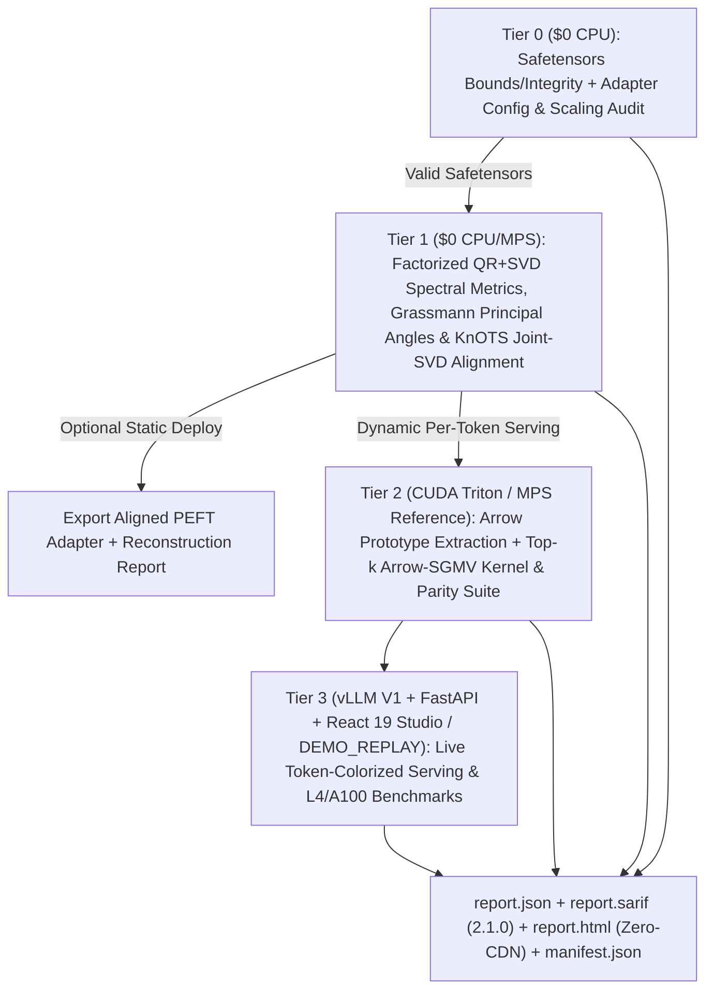

# Stage 1: Business Requirements Document (BRD) — `loraspec`

> [!NOTE]
> **Document Status**: Locked (`GATE-1` Passed)
> **Product Identity**: **`loraspec`** — LoRA Subspace Auditor (`KnOTS`) & Per-Token Top-$k$ `MoLoRA` Triton Studio
> **SDLC Methodology & Grading Rubric**: [`SPEC-GATE` 8-Stage Process & §6 Rubric](./00-CHARTER.md#5-named-sdlc-methodology-the-spec-gate-8-stage-sdlc-process)
> **Research Basis**: [RESEARCH-DOSSIER.md](./RESEARCH-DOSSIER.md)
> **Stage 2 FRD / PRD**: [02-FRD-PRD.md](./02-FRD-PRD.md)
> **Requirement Traceability Prefix**: `BRD-REQ-01` through `BRD-REQ-22` (mapped 100% into `FRD-REQ-01..36`, `FEAT-01..22`, `ARCH-COMP-01..12`, `SDD-01..05`, and [05-IMPLEMENTATION-PLAN.md](./05-IMPLEMENTATION-PLAN.md)).

---

## 1. Executive Summary & Business Problem Statement

Modern AI engineering teams increasingly train **multiple lightweight LoRA adapters** ($r \in \{8, 16, 32, 64\}$) over a single open-weight backbone (`Qwen2.5-3B`, `Qwen3-4B`, `Llama-3.1-8B`) to replace expensive `$10+/1M` closed frontier APIs with fast, specialized `$0.18/1M` serving stacks. However, moving from one LoRA to a **multi-LoRA fleet** triggers three compounding engineering and business failures:

1. **Silent Subspace Destruction During Static Merging**: Teams invoke `peft` `linear`, `TIES`, or `DARE` merges blindly. Because independently trained LoRAs possess misaligned singular bases ($B_m A_m$), opposing parameter signs and overlapping principal directions collide—degrading downstream accuracy by 5–20+ percentage points with zero pre-merge diagnostic warning.
2. **Undetected Rank Collapse & Spectral Instability**: Teams deploy rank-32 or rank-64 adapters whose effective stable rank ($r_{\text{eff}} = \|\Delta W\|_F^2 / \|\Delta W\|_2^2$) has collapsed to $1.1$–$2.0$, or whose spectral norms $\|\Delta W\|_2$ spike 10× above peer layers—burning VRAM bandwidth or destabilizing merged logits without automated CI checks.
3. **The Per-Sequence vs. Unbatched Dynamic Serving Gap**:
   - `vLLM V1`'s Punica `SGMV`/`BGMV` multi-LoRA runtime locks an entire HTTP request to **one static `LoRARequest`**, making single-prompt multi-domain composition (e.g., SQL + Rust + JSON inside one generated artifact) impossible without static merging.
   - `huggingface/peft` ships `Arrow` zero-shot routing (`create_arrow_model`) **only in unbatched eager PyTorch**, stalling decode latency and lacking continuous batching, Triton kernel acceleration, or `vLLM` integration.

### Business Opportunity
**`loraspec`** closes this entire gap in one cohesive open-source engineering platform:
- **Pre-Flight CI/CD Subspace Gate (`$0` CPU)**: Inspects `.safetensors` adapters in `< 10s` on CPU, detects rank collapse, spectral spikes, base-model SHA drift, and Grassmann subspace collisions, and emits native **SARIF 2.1.0** PR annotations + zero-CDN HTML audit cards.
- **Scalable `KnOTS` Joint-SVD Merger (`$0` CPU)**: Aligns heterogeneous-rank LoRAs into a shared orthogonal basis $U\Sigma$ before sign-consensus merging, eliminating blind merge interference.
- **Per-Token Top-$k$ `MoLoRA` Triton Engine & `vLLM V1` Plugin**: Replaces Python routing loops with a custom `@triton.jit` **Top-$k$ Segmented Gather-MatMul (`Arrow-SGMV`)** kernel with automatic CPU/MPS fallback and zero-fork `vLLM V1` entry-point registration.
- **Interactive Web Studio (`loraspec` Studio)**: Visualizes Grassmann collision chord/heatmaps, singular value scree plots, and a **Live Token-Colorized Generation Arena** (with zero-cost `DEMO_REPLAY=true` hosting + 1-command `docker compose up`).

---

## 2. Competitive & Ecosystem Non-Redundancy Matrix

| Ecosystem Tool / Paper | What It Already Solves | Exact Gap Owned by `loraspec` |
|---|---|---|
| **`huggingface/peft`** | Adapter training, `add_weighted_adapter` (`linear`, `ties_svd`, `dare_ties`), eager unbatched `ArrowConfig`/`create_arrow_model`. | Zero pre-merge Grassmann/spectral collision auditing; zero SARIF CI PR gates; no memory-safe factorized `KnOTS` CLI/merger with reconstruction diagnostics; `Arrow` lacks batched GPU Triton kernels and `vLLM` serving. |
| **`vLLM V1` (Punica)** | Continuous-batched multi-LoRA serving via `SGMV`/`BGMV` locked to one `LoRARequest` per request. | Cannot route **token-by-token Top-$k$ adapters** within a single request; lacks spectral pre-flight guards and token-level router telemetry. |
| **`gstoica27/KnOTS`** | Reference research scripts for `KnOTS` ICLR 2025 joint-SVD merging. | Research code only—no production CLI/SDK, no factorized QR+SVD memory guard, no Grassmann collision scoring, no CI action, no Triton serving, no UI. |
| **`LoRASpace` (`arXiv:2610.27444`)** | Academic paper studying pool-wide shared subspaces for multi-LoRA composition. | Not engineered as a production SARIF CI auditor, heterogeneous-rank Triton `Arrow-SGMV` kernel, `vLLM V1` plugin, or live token-colorized Studio. |
| **`loraspec` (This Product)** | Complete pre-flight audit → `KnOTS` align/merge → Triton Top-$k$ `MoLoRA` → `vLLM V1` plugin → Interactive Web Studio. | End-to-end mathematical, kernel, CI/CD, and observability loop verifiable locally on Apple Silicon at `₹0` and on L4/A100 within `₹2,000–₹3,000`. |

---

## 3. Target Personas & Value Propositions

| Persona | Core Pain Point | Value Delivered by `loraspec` |
|---|---|---|
| **P1: Inference & ML Systems Engineer** *(Baseten, Fireworks, Together, NVIDIA, Sarvam, vLLM shops)* | `vLLM` forces one static `LoRARequest` per request while eager `peft` Arrow stalls throughput; multi-rank kernels fragment VRAM. | Ships a verified `@triton.jit` **Top-$k$ `Arrow-SGMV` kernel** handling mixed ranks ($r \in \{8,16,32,64\}$), zero-fork `vLLM V1` plugin, and honest L4/A100 roofline + ITL benchmarks. |
| **P2: Startup CTO / Head of Applied AI** | Wants to replace expensive frontier prompts with specialized small LoRAs safely without catastrophic multi-task regressions or broken mixed-intent outputs. | Provides instant pre-merge risk grading (`A–F`), **`KnOTS`** accuracy preservation on static deploys, and live **per-token `MoLoRA`** routing + clickable Studio demo. |
| **P3: Post-Training / Adapter Research Engineer** | Trains dozens of LoRAs (`sql`, `rust`, `json`, `math`) and struggles with hidden rank collapse, `rsLoRA` scaling bugs, and merge interference. | Quantifies layer-by-layer effective rank $r_{\text{eff}}$, spectral norm spikes, and Grassmann principal angles in seconds without allocating $d_{\text{out}} \times d_{\text{in}}$ matrices. |
| **P4: Platform / DevSecOps & OSS Maintainer** | Bad adapter PRs (`NaN` weights, base-model SHA drift, collapsed ranks, severe collision with prod fleet) sneak into model registries. | Drops a 10-line **`sashwat2212/loraspec@v1` GitHub Action** running on `$0` CPU `ubuntu-latest` runners emitting inline **SARIF 2.1.0** annotations and HTML cards. |

---

## 4. Tiered Cost-Aware Execution Funnel

---

## 5. Business Objectives & Measurable KPIs

### 5.1 Engineering KPIs
| KPI ID | Metric | Target Threshold | Verification Method |
|---|---|---|---|
| **KPI-ENG-01** | Tier 0/1 CPU Audit Speed & Memory Bound | Audit $K=4$ `Qwen3-4B` LoRA adapters in **`< 10.0s`** on standard 4-vCPU runner with **`0` dense $d_{\text{out}}\times d_{\text{in}}$ allocations**. | Automated benchmark & memory-limit test (`tracemalloc`). |
| **KPI-ENG-02** | Triton vs. PyTorch Reference Equivalence | `@triton.jit` `Arrow-SGMV` matches PyTorch FP32/FP16 reference within `atol <= 1e-3, rtol <= 1e-3` (FP16) and `atol <= 5e-3` (BF16) across mixed ranks $r \in \{8, 16, 32, 64\}$ and $k \in \{1, 2, 3, 4\}$. | Property-based CUDA parity suite (`tests/gpu/test_triton_parity.py`). |
| **KPI-ENG-03** | Zero-Dependency / Fallback Parity | `loraspec` CLI (`doctor`, `inspect`, `audit`, `report`) installs and passes full unit suite on macOS `arm64` & CPU-only `ubuntu-latest` without CUDA or `triton`. | Dual OS CI + local sandbox verification. |
| **KPI-ENG-04** | SARIF 2.1.0 & Zero-CDN HTML Validity | Emitted `.sarif` passes strict SARIF 2.1.0 JSON schema; `.html` makes **0 external HTTP requests** and escapes untrusted metadata (`XSS-safe`). | Automated schema & regex/escape tests. |
| **KPI-ENG-05** | GPU Budget Discipline | Total E2E cloud spend stays **`<= ₹3,000`** (`--smoke` runs strictly **`< ₹10`**); `GpuBudgetGuard` halts cleanly on ceiling breach. | `BudgetGuard` unit tests + E2E billing ledger in `manifest.json`. |
| **KPI-ENG-06** | `DEMO_REPLAY=true` Live Studio Reliability | React 19 Studio boots cleanly via `docker compose up` AND serves deterministic recorded L4/A100 telemetry at **`₹0/month`** in `DEMO_REPLAY=true` mode. | Playwright / API integration smoke test. |

### 5.2 Research & Performance KPIs
| KPI ID | Metric | Target Threshold | Verification Method |
|---|---|---|---|
| **KPI-RES-01** | Planted Spectral Fault Recall | **100% recall** and **`<= 5%` false-alarm rate** across planted fixtures (dead/NaN weights, rank collapse, spectral spike, base-model mismatch, colliding sign-conflicting pair). | `benchmarks/planted_collisions/` test suite. |
| **KPI-RES-02** | `KnOTS` vs. Naive Merge Quality Lift | On multi-domain tasks across 4–6 `Qwen2.5-3B`/`Qwen3-4B` adapters, `KnOTS` achieves **statistically higher accuracy / lower cosine reconstruction error** than naive `linear` and unaligned `ties`. | Controlled 4-arm evaluation script (`recipes/molora_knots_benchmark/`). |
| **KPI-RES-03** | Triton `Arrow-SGMV` Speedup vs. Eager `peft` Arrow | Custom `@triton.jit` Top-$k$ `Arrow-SGMV` achieves **`>= 2.0x`–`3.0x` lower layer latency** and **`>= 30%` lower peak scratchpad VRAM** vs. `peft` eager Arrow at batch size $B \ge 16$. | Roofline & latency microbenchmark on L4 + A100. |
| **KPI-RES-04** | Per-Token `MoLoRA` Compositional Gain | Per-token Top-$k$ `MoLoRA` outperforms static single-LoRA and static merged baselines on **mixed-domain prompts** (e.g., Rust + JSON + SQL) with observable domain-aligned token routing. | Compositional benchmark + token-routing entropy/purity report. |

### 5.3 Showcase & Adoption KPIs
| KPI ID | Metric | Target Threshold | Verification Method |
|---|---|---|---|
| **KPI-SHW-01** | PyPI & `uvx` Frictionless UX | Installable via `pip install loraspec` / `uvx loraspec doctor` with 60-second quickstart. | Clean wheel build & smoke test. |
| **KPI-SHW-02** | GitHub Marketplace Action (`v1`) | Root `action.yml` running on `ubuntu-latest` CPU in `< 20s`, posting inline SARIF annotations on PRs modifying `.safetensors` / `adapter_config.json`. | Live GitHub workflow run on test PR. |
| **KPI-SHW-03** | Public Studio & Social Assets | Deployed clickable `DEMO_REPLAY` URL + native 60fps `.mp4` arena clip + L4/A100 charts generated from `scripts/export_social_assets.py`. | Verified live URL + generated assets in `assets/social/`. |

---

## 6. Graded Business Requirements Register (`BRD-REQ-01` – `BRD-REQ-22`)

All 22 business requirements are graded using the locked **Unified Multi-Dimensional Grading Rubric** in [00-CHARTER.md §6](./00-CHARTER.md#6-unified-multi-dimensional-grading-rubric).

### A. Adapter Inspection, Integrity & Spectral Subspace Auditing
| ID | Priority | MoSCoW | Impact / Risk | Complexity | Tier | Milestone | Linked KPIs | Verification Gate | Requirement Statement | Measurable Acceptance Criterion | Sign-Off Owner |
|---|---|---|---|---|---|---|---|---|---|---|---|
| **BRD-REQ-01** | `P0` | `Must` | `G1-Critical` | `M` | `T0` (`₹0`) | `Stage 5` | `KPI-ENG-01`, `KPI-ENG-03`, `KPI-SHW-01` | `GATE-5` | The system shall safely parse `.safetensors` adapter weights and PEFT `adapter_config.json` files without executing arbitrary Python (`pickle`-free), validating bounds on header size (`0 < N <= 100 MiB`), non-overlapping tensor offsets, shapes, dtypes (`F32`/`F16`/`BF16`), and `lora_A`/`lora_B` layer pairings. | Malformed headers, truncated payloads, overlapping slices, `.bin` checkpoints, unpaired halves, or out-of-bounds offsets raise `AdapterParseError` (`EXIT_CONFIG_ERROR = 2`); valid adapters normalize into `LoRAAdapterSpec` with `F32`/`F16`/`BF16` roundtrip accuracy. | Security & QA Lead |
| **BRD-REQ-02** | `P0` | `Must` | `G2-High` | `S` | `T0` (`₹0`) | `Stage 5` | `KPI-ENG-03`, `KPI-RES-01` | `GATE-5` | The system shall compute exact SHA-256 adapter fingerprints and audit configuration consistency across a multi-adapter fleet (`base_model_name_or_path` parity, scaling factor $\alpha/r$ vs rsLoRA $\alpha/\sqrt{r}$, missing MLP all-linear target modules, heterogeneous ranks). | Base-model/dimension mismatches emit `CRITICAL` (`RULE-CONF-001`); missing/corrupt config or alpha/rank mismatch emit `HIGH` (`RULE-CONF-002`); attention-only LoRAs emit `HIGH` (`RULE-CONF-003`); mixed ranks/rsLoRA emit `MEDIUM` (`RULE-CONF-004`). | Post-Training Lead |
| **BRD-REQ-03** | `P0` | `Must` | `G1-Critical` | `L` | `T1` (`₹0`) | `Stage 5` | `KPI-ENG-01`, `KPI-ENG-03`, `KPI-RES-01` | `GATE-5` | The system shall compute layer-wise spectral health metrics—singular values $\sigma_1 \dots \sigma_r$, spectral norm $\|\Delta W\|_2$, Frobenius norm $\|\Delta W\|_F$, effective stable rank $r_{\text{eff}} = \|\Delta W\|_F^2 / \|\Delta W\|_2^2$, rank utilization, and condition number—strictly via factorized thin QR+SVD without materializing dense $d_{\text{out}} \times d_{\text{in}}$ matrices. | Dead/NaN weights emit `CRITICAL` (`RULE-SPEC-001`); rank collapse ($r_{\text{eff}}/r < 0.20$ or $\ge 30\%$ layers with top-1 energy $> 0.85$) emits `HIGH` (`RULE-SPEC-002`); spectral spikes ($> \max(10, 5\cdot\text{med})$) emit `HIGH` (`RULE-SPEC-003`); `0` dense $d_{\text{out}} \times d_{\text{in}}$ allocations. | ML Systems Lead |
| **BRD-REQ-04** | `P0` | `Must` | `G2-High` | `L` | `T1` (`₹0`) | `Stage 5` | `KPI-ENG-01`, `KPI-RES-01` | `GATE-5` | The system shall compute pairwise **Grassmann principal angles**, **chordal similarity**, **geodesic distance**, and **gauge-invariant directional sign-conflict rates** across all adapter pairs $(m_a, m_b)$ per layer to detect subspace interference prior to merging. | Colliding pairs (`chordal >= 0.70` and `sign_conflict >= 0.35` on `>= 20%` shared layers) emit `CRITICAL` (`RULE-SPEC-004`); `chordal >= 0.45` emits `HIGH` (`RULE-SPEC-004`); identity subspaces yield `0°` / `chordal=1.0` and orthogonal yield `90°` / `chordal=0.0`. | Post-Training Lead |
| **BRD-REQ-05** | `P0` | `Must` | `G2-High` | `S` | `T1` (`₹0`) | `Stage 5` | `KPI-ENG-03`, `KPI-RES-01` | `GATE-5` | The system shall synthesize a deterministic **`MergeRiskScore (0.0–100.0)`**, **Certification Grade (`A–F`)**, and actionable deployment policy (`SAFE_LINEAR_MERGE`, `USE_KNOTS_ALIGNMENT`, `USE_TOP_K_MOLORA`, `RETRAIN_COLLAPSED_LORA`, `QUARANTINE_CORRUPT_ADAPTER`). | Identical adapters and `loraspec.toml` yield bitwise-identical `merge_risk_score`, `grade`, and `recommendations` across macOS `arm64` and Linux `x86_64`, passing exact Grade `A/B/C/D/F` transition boundary assertions. | Product Owner |

### B. `KnOTS` Joint-SVD Subspace Alignment & Merging Engine
| ID | Priority | MoSCoW | Impact / Risk | Complexity | Tier | Milestone | Linked KPIs | Verification Gate | Requirement Statement | Measurable Acceptance Criterion | Sign-Off Owner |
|---|---|---|---|---|---|---|---|---|---|---|---|
| **BRD-REQ-06** | `P1` | `Must` | `G2-High` | `L` | `T1` (`₹0`) | `M1` | `KPI-ENG-01`, `KPI-RES-02` | `GATE-6 (M1)` | The system shall implement a scalable, factorized **`KnOTS` Joint-SVD Alignment** merger supporting heterogeneous ranks ($r_m \in \{4, 8, 16, 32, 64, 128\}$), projecting adapter updates into a shared orthogonal singular basis $U\Sigma$ before merging in aligned $V^T$-space. | Matches brute-force dense SVD $\Delta W_{\text{stack}}$ on synthetic layers within `atol < 1e-5` without allocating $d_{\text{out}} \times (K d_{\text{in}})$ matrices; merges $K \ge 2$ mixed-rank adapters on CPU. | ML Systems Lead |
| **BRD-REQ-07** | `P1` | `Must` | `G2-High` | `M` | `T1` (`₹0`) | `M1` | `KPI-RES-02` | `GATE-6 (M1)` | The system shall support three aligned combination modes—`knots_ties` (trim + sign-elect + disjoint merge), `knots_dare_ties` (stochastic drop-rescale + TIES), and `knots_linear`—plus optional `GenKnowSub` general-knowledge subtraction (`--gks-adapter`). | Seeded `knots_dare_ties` and deterministic `knots_ties` / `knots_linear` emit PEFT-compatible `adapter_model.safetensors`, `adapter_config.json`, and `knots_merge_manifest.json` loadable by `peft`. | Post-Training Lead |
| **BRD-REQ-08** | `P1` | `Should` | `G2-High` | `M` | `T1` (`₹0`) | `M1` | `KPI-RES-02` | `GATE-6 (M1)` | Every `KnOTS` merge shall compute and verify per-layer **singular energy retention $\eta_k$** and **factorized Frobenius reconstruction RMSE**, automatically comparing alignment reduction in sign conflicts vs. unaligned TIES. | Emits `KnOTSMergeSummary` with `energy_retained`, `mean_reconstruction_rmse`, and `sign_conflict_reduction_pct`; emits `RULE-KNOTS-001` (`MEDIUM`) whenever $\eta < 0.90$. | Post-Training Lead |

### C. Per-Token Top-$k$ `Arrow` Spectral Routing & Custom `@triton.jit` `Arrow-SGMV` Kernel
| ID | Priority | MoSCoW | Impact / Risk | Complexity | Tier | Milestone | Linked KPIs | Verification Gate | Requirement Statement | Measurable Acceptance Criterion | Sign-Off Owner |
|---|---|---|---|---|---|---|---|---|---|---|---|
| **BRD-REQ-09** | `P1` | `Must` | `G2-High` | `M` | `T2` | `M2` | `KPI-RES-04` | `GATE-6 (M2)` | The system shall extract normalized `Arrow` spectral routing prototypes $p_m^{(\ell)}$ (top right singular vector, optionally `GenKnowSub`-purified) for each adapter layer and compute temperature-scaled per-token Top-$k$ routing weights $g_{t,m} = \text{softmax}(\tau^{-1}\text{TopK}(|\hat{x}_t^T p_m|))$. | Prototypes extract deterministically from `.safetensors` weights with zero router training; sign flips $(B,-A) \to (-B,A)$ produce invariant routing scores (`abs diff <= 1e-6`); Shannon entropy $H_t$ tracked per token. | ML Systems Lead |
| **BRD-REQ-10** | `P1` | `Must` | `G1-Critical` | `XL` | `T2` | `M2` | `KPI-ENG-02`, `KPI-RES-03` | `GATE-6 (M2)` | The system shall implement a custom two-stage **`@triton.jit` Top-$k$ Segmented Gather-MatMul (`Arrow-SGMV`)** kernel in CUDA supporting continuous-batched token streams, mixed adapter ranks ($r_m \in \{8, 16, 32, 64\}$), and FP16/BF16 I/O with FP32 accumulation and deterministic slot reduction. | Passes 100+ randomized property-based parity tests (`atol <= 1e-3` FP16, `<= 5e-3` BF16) against PyTorch FP32 reference across $T \in [1..2048]$, empty expert buckets, and ragged mixed ranks (`EXIT_PARITY_ERROR=5` on breach). | ML Systems Lead |
| **BRD-REQ-11** | `P1` | `Must` | `G1-Critical` | `M` | `T2` (`₹0` local) | `M2` | `KPI-ENG-02`, `KPI-ENG-03` | `GATE-6 (M2)` | The kernel subsystem shall provide an automatic **PyTorch CPU/MPS reference backend** (plus minimal pure-Python diagnostic fallback) behind `ArrowMoLoRADispatcher` so all routing and `MoLoRA` tests execute on Apple Silicon M5 and CPU CI without CUDA. | Setting `backend="auto"` transparently picks `triton_cuda` on CUDA+Triton hosts and `torch_mps`/`torch_cpu` on macOS/CPU CI with identical API and telemetry schema. | ML Systems Lead |
| **BRD-REQ-12** | `P1` | `Should` | `G2-High` | `M` | `T2` | `M2` | `KPI-ENG-02`, `KPI-ENG-05`, `KPI-RES-03` | `GATE-6 (M2)` | The system shall provide a reproducible `loraspec bench` microbenchmark harness measuring kernel latency (ms), TFLOP/s, achieved HBM bandwidth (GB/s), and peak scratchpad VRAM against `peft` eager Arrow and `vLLM` static baselines. | Achieves `>= 2.0x–3.0x` latency speedup and `>= 30%` scratchpad VRAM reduction vs. `peft` eager Arrow at $B \ge 16$; enforces `--smoke` (`< ₹10`) guard cleanly. | ML Systems Lead |

### D. `vLLM V1` Plugin & FastAPI Streaming Telemetry Gateway
| ID | Priority | MoSCoW | Impact / Risk | Complexity | Tier | Milestone | Linked KPIs | Verification Gate | Requirement Statement | Measurable Acceptance Criterion | Sign-Off Owner |
|---|---|---|---|---|---|---|---|---|---|---|---|
| **BRD-REQ-13** | `P2` | `Should` | `G2-High` | `L` | `T3` | `M3` | `KPI-RES-04` | `GATE-6 (M3)` | The system shall ship a zero-fork **`vLLM V1` plugin** registered via `[project.entry-points."vllm.general_plugins"]` enabling per-token Top-$k$ `Arrow-SGMV` dynamic routing across loaded adapters without modifying `vLLM` source files. | `importlib.metadata.entry_points(group="vllm.general_plugins")` resolves `loraspec.serving.vllm_plugin:register`; worker hook routes mixed-domain prompt tokens across distinct adapters with non-blocking ring buffer capture. | ML Systems Lead |
| **BRD-REQ-14** | `P2` | `Should` | `G2-High` | `L` | `T3` | `M3` | `KPI-ENG-06` | `GATE-6 (M3)` | The system shall provide a **FastAPI OpenAI-compatible `/v1/chat/completions` gateway, Studio REST API (`/api/v1/*`), and `/ws/telemetry` WebSocket bus** streaming tokens alongside real-time Top-$k$ adapter IDs, weights, router entropy, and ITL/TTFT metrics. | Every streamed SSE chunk and WebSocket frame validates against `MoLoRARouteTelemetry`; `/health`, `/api/v1/adapters`, `/api/v1/audit`, `/api/v1/knots/preview`, and `/api/v1/benchmarks` pass FastAPI integration tests. | Platform Lead |
| **BRD-REQ-15** | `P2` | `Should` | `G2-High` | `M` | `T3` (`₹0`) | `M3` | `KPI-ENG-06`, `KPI-SHW-03` | `GATE-6 (M3)` | The backend shall implement **`DEMO_REPLAY=true`** mode replaying authentic recorded L4/A100 GPU telemetry traces and token-routing streams identically over `/v1/chat/completions` and `/ws/telemetry` with zero GPU attached. | Boots and serves recorded sessions (`1.0x`, `2.0x`, `instant`) on CPU-only host/serverless tier at `₹0/month` hosting cost while preserving exact REST/WS schemas. | Product Owner |

### E. Interactive React 19 Web Studio (`loraspec` Studio)
| ID | Priority | MoSCoW | Impact / Risk | Complexity | Tier | Milestone | Linked KPIs | Verification Gate | Requirement Statement | Measurable Acceptance Criterion | Sign-Off Owner |
|---|---|---|---|---|---|---|---|---|---|---|---|
| **BRD-REQ-16** | `P2` | `Should` | `G3-Standard` | `L` | `T3` (`₹0`) | `M3` | `KPI-ENG-06`, `KPI-SHW-03` | `GATE-6 (M3)` | The system shall include a dark-mode **React 19 + TypeScript + Vite + Tailwind Web Studio** exposing four interactive views: (1) Subspace Observatory, (2) `KnOTS` Alignment Lab, (3) Live Token-Colorized `MoLoRA` Arena, and (4) L4/A100 Kernel Roofline & Ablation Explorer. | `tsc --noEmit` & `vite build` pass with 0 errors; Live Arena colorizes streamed tokens by dominant adapter (`sql`, `rust`, `json`, `math`, `python`) and renders `<script>` tokens safely as escaped text (0 XSS executions). | Product Owner |
| **BRD-REQ-17** | `P2` | `Could` | `G3-Standard` | `S` | `T3` (`₹0`) | `M3` | `KPI-ENG-06` | `GATE-6 (M3)` | The full stack (FastAPI backend + React 19 UI + `DEMO_REPLAY=true` default or optional GPU runtime profile) shall launch via a single **`docker compose up`** command. | Cold `docker compose up` reaches HTTP `200` on `/health` and serves built React UI within `< 30s` on macOS OrbStack and Linux Docker. | Platform Lead |

### F. Reporting, CI/CD Action, Cost Guardrails & Empirical Study
| ID | Priority | MoSCoW | Impact / Risk | Complexity | Tier | Milestone | Linked KPIs | Verification Gate | Requirement Statement | Measurable Acceptance Criterion | Sign-Off Owner |
|---|---|---|---|---|---|---|---|---|---|---|---|
| **BRD-REQ-18** | `P0` | `Must` | `G1-Critical` | `M` | `T0` (`₹0`) | `Stage 5` (HTML `M1`) | `KPI-ENG-04` | `GATE-5` / `GATE-6 (M1)` | The system shall emit synchronized **`report.json`**, **`report.sarif` (SARIF 2.1.0)**, zero-CDN offline **`report.html`**, and **`manifest.json`** per audit run with repo-relative normalized URIs (preserving dotfiles) and strict XSS escaping. | `report.sarif` validates against OASIS SARIF 2.1.0 schema with repo-relative URIs; `report.html` (`< 250 KB`, Jinja2 `autoescape=True`) makes `0` external HTTP requests and escapes adversarial adapter metadata. | Security & QA Lead |
| **BRD-REQ-19** | `P0` | `Must` | `G1-Critical` | `M` | `T0` (`₹0`) | `Stage 5` | `KPI-ENG-03`, `KPI-SHW-01` | `GATE-5` | The system shall provide a deterministic CLI (`doctor`, `inspect`, `audit`, `merge`, `bench`, `serve`, `replay`, `report`), strict `loraspec.toml` config (`extra="forbid"`), and documented exit codes `0–5`. | Invalid configs, inverted thresholds, or malformed `.safetensors` exit `EXIT_CONFIG_ERROR (2)`; findings `>= --fail-on` exit `EXIT_AUDIT_FAIL (1)`; out-of-tree `uvx` wheel smoke test passes on clean OS. | Engineering Lead |
| **BRD-REQ-20** | `P1` | `Should` | `G2-High` | `S` | `T0` (`₹0`) | `M1` | `KPI-ENG-04`, `KPI-SHW-02` | `GATE-6 (M1)` / `GATE-7` | The system shall ship a drop-in **GitHub Marketplace Composite Action (`action.yml`)** running CPU-natively on `ubuntu-latest` in `< 20s` at `$0`, posting inline SARIF annotations and uploading the offline HTML Certification Card. | Test PR modifying colliding or collapsed adapter fails CI cleanly in `< 20s`, uploads valid SARIF 2.1.0 to Code Scanning, and publishes `grade` and `merge-risk-score` outputs. | Platform Lead |
| **BRD-REQ-21** | `P0` | `Must` | `G1-Critical` | `M` | `T0..T3` | `Stage 5` | `KPI-ENG-05` | `GATE-5` | Every GPU benchmark or training script shall integrate **`GpuBudgetGuard`** + `--smoke` (`< ₹10`) mode enforcing hard INR/hour caps (`₹3,000` ceiling incl. 18% GST) and immutable `RunManifest` logging. | `asyncio.Lock`-protected `reserve_or_raise` prevents concurrent overrun; exceeding `--max-cost-inr` or `--smoke` cap raises `BudgetExceededError` (`EXIT_BUDGET_EXCEEDED = 3`). | Engineering Lead |
| **BRD-REQ-22** | `P2` | `Should` | `G3-Standard` | `XL` | `T2..T3` | `M4` | `KPI-ENG-05`, `KPI-RES-02`, `KPI-RES-03`, `KPI-RES-04`, `KPI-SHW-03` | `GATE-6 (M4)` / `GATE-7` | The repository shall include reproducible 4-arm L4 + A100 empirical benchmarks (`recipes/molora_knots_benchmark/`) and automated visual/video export tooling (`scripts/export_social_assets.py`) within `₹2,000–₹3,000` total spend. | Publishes verified accuracy, ITL, throughput, VRAM, and exact INR billing tables in `docs/TECHNICAL-REPORT.md` plus `2×`-DPI plots and 60fps UI `.mp4` with total `manifest.json` cost `<= ₹3,000`. | Product Owner |

---

## 7. Constraints, Assumptions & Risk Register

| Risk ID | Risk Description | Impact Grade | Mitigation Strategy |
|---|---|---|---|
| **RISK-01** | **Ragged Triton Pointer Arithmetic / Race Conditions** in `Arrow-SGMV` across heterogeneous ranks $r \in \{8, 16, 32, 64\}$. | `G1-Critical` | Stage 2 deterministic segment sorting (`sorted_token_ids`, `expert_offsets`) + explicit `offs_r < rank_e` masking + 100+ randomized property-based equivalence tests against PyTorch FP32 reference (`KPI-ENG-02`). |
| **RISK-02** | **Upstream `vLLM V1` Internal API Churn** across minor releases (`PunicaWrapper` hooks). | `G2-High` | Isolate all `vLLM` hooks inside a single adapter module (`src/loraspec/serving/vllm_plugin.py`) registered via stable `vllm.general_plugins` entry point; pin tested `vLLM` minor version in `[project.optional-dependencies]`. |
| **RISK-03** | **GPU Spend Overrun (`> ₹3,000`)** on E2E L4/A100 instances. | `G1-Critical` | Develop 100% of math, UI, API, and PyTorch parity tests on M5 Mac at `₹0`; enforce mandatory `--smoke` (`< ₹10`) dry runs before sweeps; reserve A100 strictly for a pre-scripted 1.5–2 hr roofline run. |
| **RISK-04** | **Slow/OOM Dense SVD on Large Adapters** during CPU GitHub Actions (`ubuntu-latest` 7–16 GB RAM). | `G2-High` | Never materialize $d_{\text{out}} \times d_{\text{in}}$ matrices (`SDD-01` & `SDD-02`); operate exclusively on factorized $Q_B R_B, Q_A R_A$ thin QR factors (`< 10s` CPU runtime, `< 250 MB` peak RAM). |
| **RISK-05** | **Offline/Minimal Environment Failures** when `torch` or `triton` is absent (e.g., CI SARIF runners or fresh `uvx loraspec`). | `G2-High` | Keep core PyPI runtime ultra-lightweight; put heavy CUDA/serving deps in clean optional extras (`[spectral]`, `[kernels]`, `[serving]`, `[studio]`) with pure-Python `.safetensors` & fallback math for Tier 0 inspection/auditing. |
| **RISK-06** | **XSS or DoS via Untrusted `.safetensors` Headers** uploaded to Studio or audited in CI. | `G1-Critical` | Enforce strict 8-byte header size ceiling (`<= 100 MB` JSON header), offset monotonicity/bounds checks, and Jinja2 `autoescape=True` on all HTML reports and React token rendering. |

---

## 8. Stage 1 Exit Gate (`GATE-1`) & Stakeholder Sign-Off Matrix

All **22 Graded Business Requirements (`BRD-REQ-01`–`BRD-REQ-22`)**, **13 KPIs (`KPI-ENG-01..06`, `KPI-RES-01..04`, `KPI-SHW-01..03`)**, and **6 Risk Mitigations (`RISK-01..06`)** satisfy `GATE-1` criteria and trace forward into [Stage 2 FRD / PRD (`02-FRD-PRD.md`)](./02-FRD-PRD.md).

| Stakeholder Role | Owned `BRD-REQ` Scope | Mandatory Sign-Off Thresholds | Gate Verification |
|---|---|---|---|
| **Security & QA Lead** | `BRD-REQ-01`, `BRD-REQ-18` | 0 unsafe `pickle` loads; 100% bounds-checked `.safetensors` rejections (`EXIT_CONFIG_ERROR=2`); OASIS SARIF 2.1.0 & XSS-safe zero-CDN HTML. | `GATE-5`, `GATE-6 (M1)` |
| **Post-Training Lead** | `BRD-REQ-02`, `BRD-REQ-04`, `BRD-REQ-07`, `BRD-REQ-08` | 100% recall / `<= 5%` FAR on planted faults (`KPI-RES-01`); `KnOTS` conflict reduction & accuracy lift (`KPI-RES-02`). | `GATE-5`, `GATE-6 (M1)` |
| **ML Systems Lead** | `BRD-REQ-03`, `BRD-REQ-06`, `BRD-REQ-09`, `BRD-REQ-10`, `BRD-REQ-11`, `BRD-REQ-12`, `BRD-REQ-13` | `0` dense $O(d^2)$ allocations (`KPI-ENG-01`); Triton parity `atol <= 1e-3` FP16 / `<= 5e-3` BF16 (`KPI-ENG-02`); `>= 2.0x–3.0x` speedup (`KPI-RES-03`); zero-fork `vLLM V1` hook. | `GATE-5`, `GATE-6 (M1..M3)` |
| **Engineering / Platform Lead** | `BRD-REQ-14`, `BRD-REQ-17`, `BRD-REQ-19`, `BRD-REQ-20`, `BRD-REQ-21` | Deterministic CLI (`0–5`); `GpuBudgetGuard` cap `<= ₹3,000` (`KPI-ENG-05`); `< 20s` CPU Action (`KPI-SHW-02`); `< 30s` Docker Compose boot. | `GATE-5`, `GATE-6 (M1, M3)` |
| **Product Owner** | `BRD-REQ-05`, `BRD-REQ-15`, `BRD-REQ-16`, `BRD-REQ-22` | Reproducible `MergeRiskScore` + Grade `A–F`; `₹0/month` `DEMO_REPLAY=true` Studio (`KPI-ENG-06`); complete 4-arm L4/A100 study & public launch (`KPI-SHW-03`). | `GATE-5`, `GATE-6 (M3, M4)`, `GATE-7` |
