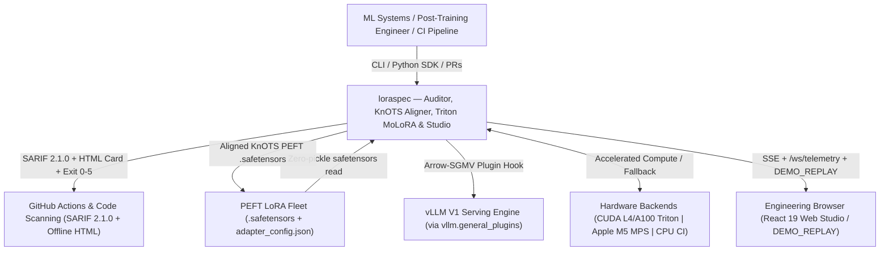
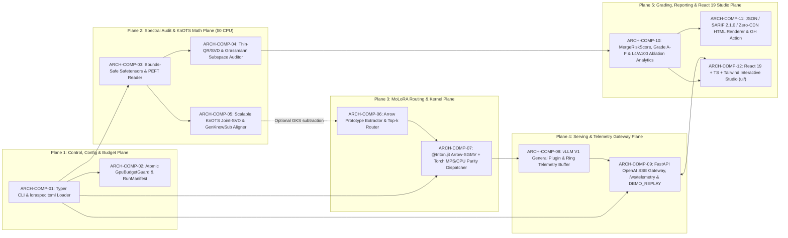
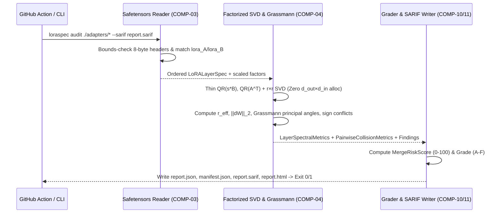
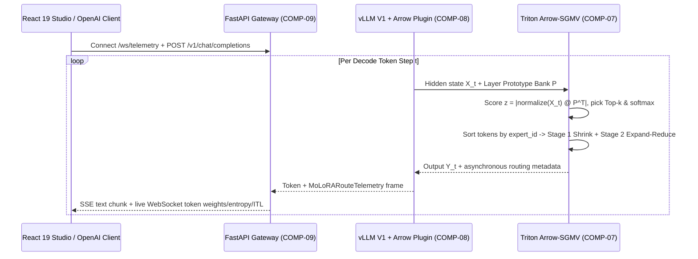

# Stage 3: High-Level System Architecture & ADRs — `loraspec`

> [!NOTE]
> **Document Status**: Locked (`GATE-3` Passed)
> **Product**: **`loraspec`** — LoRA Subspace Auditor (`KnOTS`) & Per-Token Top-$k$ `MoLoRA` Triton Studio
> **Upstream References**: [00-CHARTER.md](./00-CHARTER.md) | [01-BRD.md](./01-BRD.md) | [02-FRD-PRD.md](./02-FRD-PRD.md)
> **Component ID Convention**: `ARCH-COMP-01` through `ARCH-COMP-12` (traced backward to `FEAT-*` and forward to Stage 4 `SDD-01`..`SDD-05`).

---

## 1. Core Architectural Principles & System Invariants

1. **Factorized $O((d_{\text{out}}+d_{\text{in}})r)$ Linear Algebra Everywhere**: Neither the Spectral Auditor nor the `KnOTS` Aligner ever allocates a dense $d_{\text{out}} \times d_{\text{in}}$ $\Delta W$ matrix. All singular values, Grassmann principal angles, and joint-SVD projections operate strictly via thin QR + compressed $r \times r$ SVD.
2. **Zero-GPU CI Guarantee (`$0` CPU Control Path)**: `loraspec` separates pure-CPU spectral inspection, Grassmann auditing, SARIF/HTML reporting, and `KnOTS` merging from optional CUDA/Triton/vLLM dependencies—ensuring PR gates complete in `< 20s` on free `ubuntu-latest` runners.
3. **Single Source of Mathematical Truth Across Backends**: The Triton `@triton.jit` `Arrow-SGMV` CUDA kernel, PyTorch MPS/CPU dispatcher, and pure-Python diagnostic fallback share identical routing semantics, scaling (`rslora` vs standard $\alpha/r$), and deterministic slot summation, verified continuously by property-based numerical equivalence tests.
4. **Non-Forking Upstream Ecosystem Integration**: Interoperates cleanly with Hugging Face `peft` (`.safetensors` + `adapter_config.json`) and `vLLM V1` (`[project.entry-points."vllm.general_plugins"]`) without maintaining custom forks.
5. **Strict Cost & Malformed-Binary Guardrails**: All `.safetensors` reads validate 8-byte header bounds before memory allocation (`pickle`-free), and all cloud GPU sweeps run behind an atomic `GpuBudgetGuard` with mandatory `--smoke` (`< ₹10`) pre-flight gates.

---

## 2. C4 Level 1 — System Context Diagram



---

## 3. C4 Level 2 — Five-Plane Component Architecture



### Component Registry (`ARCH-COMP-01` – `ARCH-COMP-12`)

| Component ID | Plane | Primary Responsibility | Linked Features | Stage 4 SDD |
|---|---|---|---|---|
| **`ARCH-COMP-01`** | Control | Typer CLI (`doctor`, `inspect`, `audit`, `merge`, `bench`, `serve`, `replay`, `report`), `loraspec.toml` (`extra="forbid"`), deterministic exit codes `0–5`. | `FEAT-19` | `SDD-05` |
| **`ARCH-COMP-02`** | Control | `asyncio.Lock`-protected `GpuBudgetGuard` (`max_cost_inr`, `--smoke < ₹10`), SHA-256 `RunManifest`, host/CUDA/MPS detector. | `FEAT-21` | `SDD-05` |
| **`ARCH-COMP-03`** | Spectral | Pickle-free bounds-checked `.safetensors` header & `F32`/`F16`/`BF16` binary reader/writer + PEFT `adapter_config.json` `lora_A`/`lora_B` matcher. | `FEAT-01` | `SDD-01` |
| **`ARCH-COMP-04`** | Spectral | Factorized QR+SVD singular spectrum, $r_{\text{eff}}$, spectral norm spikes, Grassmann principal angles/chordal/geodesic collision, sign conflict, `RULE-*` rules. | `FEAT-02`, `FEAT-03`, `FEAT-04` | `SDD-01` |
| **`ARCH-COMP-05`** | Spectral | Scalable factorized `KnOTS` joint-SVD alignment (`knots_ties`, `knots_dare_ties`, `knots_linear`), mixed-rank support, `GenKnowSub` subtraction, PEFT export. | `FEAT-06`, `FEAT-07`, `FEAT-08` | `SDD-02` |
| **`ARCH-COMP-06`** | Kernels | Extracts unit-norm dominant singular prototypes $p_m^{(\ell)}$ per layer; executes sign-invariant cosine Top-$k$ routing with softmax temperature & entropy tracking. | `FEAT-09` | `SDD-03` |
| **`ARCH-COMP-07`** | Kernels | Token-to-expert segment sorter + two-stage `@triton.jit` `Arrow-SGMV` shrink/expand CUDA kernels (ragged rank masking) + PyTorch MPS/CPU reference + parity bench. | `FEAT-10`, `FEAT-11`, `FEAT-12` | `SDD-03` |
| **`ARCH-COMP-08`** | Serving | Zero-fork `vLLM V1` entry-point plugin (`vllm.general_plugins`) replacing static `LoRARequest` linear hooks with `ArrowMoLoRADispatcher` + lock-free telemetry ring buffer. | `FEAT-13` | `SDD-04` |
| **`ARCH-COMP-09`** | Serving | FastAPI `/v1/chat/completions` SSE endpoint, `/api/v1/*` audit/merge REST endpoints, `/ws/telemetry` WebSocket broadcaster, and `DEMO_REPLAY=true` recorded stream player. | `FEAT-14`, `FEAT-15`, `FEAT-17` | `SDD-04` |
| **`ARCH-COMP-10`** | Studio/Eval | `MergeRiskScore (0–100)`, Grade `A–F`, deployment policy recommender, 4-arm L4/A100 ablation metrics & social chart pipeline. | `FEAT-05`, `FEAT-22` | `SDD-01`, `SDD-05` |
| **`ARCH-COMP-11`** | Studio/Eval | Synchronized `report.json`, `manifest.json`, OASIS **SARIF 2.1.0** (git-repo-relative URIs), zero-CDN Jinja2 `report.html`, and root `action.yml`. | `FEAT-18`, `FEAT-20` | `SDD-05` |
| **`ARCH-COMP-12`** | Studio/Eval | React 19 + TypeScript + Vite + Tailwind dark-mode Studio (Grassmann heatmap, `KnOTS` lab, live token-colorized Arena, L4/A100 Roofline explorer). | `FEAT-16`, `FEAT-17` | `SDD-04` |

---

## 4. Security, Precision & Failure Threat Model (`T1`–`T6`)

| Threat Vector | Failure / Attack Scenario | Architectural Control |
|---|---|---|
| **T1: Pickle / Code Execution on Untrusted Weights** | Malicious `.bin` checkpoint embeds arbitrary `pickle` RCE gadgets. | Reject `.bin` by default (`--allow-unsafe-pickle` prohibited in CI Action); parse `.safetensors` exclusively via pure-binary JSON+tensor bounds reader (`ARCH-COMP-03`). |
| **T2: Malformed `.safetensors` Header DoS / OOM** | Crafted `.safetensors` declares `header_len = 2^62` or overlapping out-of-bounds tensor offsets. | Enforce `header_len <= 100 MB`, `8 + header_len <= file_size`, monotonic offset bounds checking before slicing (`SDD-01`). |
| **T3: Silent Numerical Divergence in Triton Kernel** | Ragged rank masking (`offs_r < rank_e`) or FP16 accumulator overflow corrupts logits silently. | Accumulate strictly in `tl.float32`, perform deterministic slot reduction over `k` instead of racy cross-expert atomics, enforce automated FP16/BF16 parity tests (`SDD-03`). |
| **T4: Runaway Cloud GPU Billing (`> ₹3,000`)** | Benchmark sweep or LoRA prep runs past credit allocation on E2E L4/A100. | Centralized `GpuBudgetGuard` checks wall-clock elapsed rate against `max_cost_inr`; `--smoke` caps dry-run loops under `₹10`. |
| **T5: Stored XSS in Offline HTML / Web Studio** | Adversarial adapter `base_model_name_or_path` or generated token contains `<script>alert(1)</script>`. | Jinja2 `autoescape=True` for `report.html`; React automatic DOM escaping for streamed token text; no `dangerouslySetInnerHTML`. |
| **T6: Path Traversal in SARIF / Export Paths** | Nested or relative adapter paths escape repo root or leak host filesystem paths. | Normalize SARIF `artifactLocation.uri` cleanly to repo-relative POSIX paths; validate output write targets (`SDD-05`). |

---

## 5. End-to-End Execution Sequence Diagrams

### 5.1 Flow 1 — `$0` CPU Pre-Flight Spectral Audit & PR SARIF Gate (`Tier 0–1`)


### 5.2 Flow 2 — Per-Token Top-$k$ `Arrow-SGMV` Inference & Live Studio Telemetry (`Tier 2–3`)


---

## 6. Planned Repository & Package Topology (`/Users/sashwatsinha/projects/loraspec`)

```text
loraspec/
├── pyproject.toml                   # uv + hatchling, entry points (loraspec CLI & vllm.general_plugins)
├── loraspec.toml.example            # Reference configuration
├── README.md                        # Quickstart, empirical highlights, architecture & docs index
├── LICENSE                          # Apache-2.0
├── SECURITY.md                      # Binary bounds, zero-pickle, budget & UI security policy
├── CONTRIBUTING.md                  # PR & test guidelines
├── CODE_OF_CONDUCT.md               # Contributor Covenant
├── CITATION.cff                     # Citation metadata
├── action.yml                       # Root $0 CPU GitHub Marketplace Composite Action (M1)
├── Dockerfile                       # Multi-stage FastAPI + React 19 Studio container (M3)
├── docker-compose.yml               # 1-command Studio launcher (DEMO_REPLAY=true default) (M3)
├── docs/                            # Complete locked SDLC corpus (Stages 0-5 + TECHNICAL-REPORT.md)
├── src/loraspec/
│   ├── __init__.py
│   ├── py.typed
│   ├── cli/                         # Typer commands (doctor, inspect, audit, merge, bench, serve, replay, report)
│   ├── core/                        # errors.py, schemas.py, config.py, budget.py, manifest.py, spectral_math.py
│   ├── inspect/                     # safetensors_reader.py (pickle-free binary parser & PEFT matcher)
│   ├── auditor/                     # probes.py (RULE-CONF/SPEC-*), grading.py (MergeRiskScore & Grade A-F)
│   ├── knots/                       # aligner.py (factorized KnOTS), operators.py (TIES/DARE/GKS), serializer.py [M1]
│   ├── kernels/                     # router.py, arrow_sgmv.py (@triton.jit), reference.py, dispatch.py, bench.py [M2]
│   ├── serving/                     # vllm_plugin.py, gateway.py (FastAPI + WS), demo_replay.py [M3]
│   └── reporting/                   # json_writer.py, sarif_writer.py, html_renderer.py (Jinja2 zero-CDN) [M1]
├── ui/                              # React 19 + TypeScript + Vite + Tailwind Dark-Mode Studio [M3]
├── assets/demo_replays/             # Authentic recorded L4/A100 telemetry JSONL for DEMO_REPLAY=true [M3-M4]
├── benchmarks/planted_collisions/   # Synthetic fault corpus for KPI-RES-01 (100% recall check) [M1]
├── recipes/molora_knots_benchmark/  # Budget-guarded E2E L4 + A100 4-arm ablation & --smoke suite [M4]
├── scripts/export_social_assets.py  # 2x DPI charts + 60fps Playwright MP4 arena recorder [M4]
├── .github/workflows/ci.yml         # ubuntu-latest CI (ruff, pyright, pytest, CLI smoke)
└── tests/
    ├── unit/                        # Zero-GPU offline/CPU unit tests (Stage 5 + M1)
    ├── integration/                 # End-to-end KnOTS merge, FastAPI WS, DEMO_REPLAY tests (M1-M3)
    └── gpu/                         # @pytest.mark.cuda property-based Triton vs PyTorch parity tests (M2)
```

---

## 7. Architecture Decision Records (`ADR-001` – `ADR-009`)

| ADR ID | Decision | Rationale & Trade-Off |
|---|---|---|
| **`ADR-001`** | **Python Packaging & Quality Toolchain (`uv` + `hatchling` + `ruff` + strict `pyright` + `pytest`)** | Instant lockfiles, `uvx loraspec` UX, zero-ambiguity strict typing matching `dasv`'s engineering standard. |
| **`ADR-002`** | **Lightweight Core Deps + Optional Extras (`[spectral]`, `[kernels]`, `[serving]`, `[studio]`) + Pure-Python `.safetensors` Fallback** | Keeps `uvx loraspec doctor/inspect/audit` under ~1s and works 100% offline/CPU without pulling 3 GB CUDA wheels; `[spectral]` adds BLAS/LAPACK `numpy` speed, `[kernels]` adds `torch`/`triton`. |
| **`ADR-003`** | **Factorized Thin-QR + $r \times r$ SVD (Never Materialize $\Delta W \in \mathbb{R}^{d_{\text{out}} \times d_{\text{in}}}$)** | Reduces memory by $d/r \approx 128\times$ and compute to milliseconds, letting free GitHub Actions runners audit 7B–32B LoRAs safely (`RISK-04`). |
| **`ADR-004`** | **Two-Stage Deterministic-Reduce `@triton.jit` `Arrow-SGMV` Over Unsorted Atomics** | Sorting `(token_id, slot)` by `expert_id` maximizes L2/SRAM coalescing across heterogeneous ranks ($r \in \{8,16,32,64\}$), while deterministic $k$-slot summation prevents float atomic non-determinism. |
| **`ADR-005`** | **Zero-Fork `vLLM V1` Entry-Point Plugin (`vllm.general_plugins`)** | Eliminates upstream rebase maintenance while running cleanly alongside `vLLM V1` paged KV cache and continuous batching. |
| **`ADR-006`** | **Built-In `DEMO_REPLAY=true` Mode Streaming Authentic Recorded L4/A100 Telemetry** | Enables an instant, interactive live Studio URL at `₹0/month` hosting cost while preserving identical WebSocket contracts for live GPU mode. |
| **`ADR-007`** | **Zero-CDN Offline HTML Certification Card (`Jinja2` `autoescape=True`) + OASIS SARIF 2.1.0** | Air-gap friendly, XSS-safe, attaches directly to model registry cards and GitHub Code Scanning PR tabs. |
| **`ADR-008`** | **Atomic `GpuBudgetGuard` + Mandatory `--smoke` (`< ₹10`) Before Every Cloud Sweep** | Protects the `₹2,000–₹3,000` E2E budget ceiling programmatically (`EXIT_BUDGET_EXCEEDED=3`). |
| **`ADR-009`** | **Strict Stage-by-Stage PyTorch Equivalence Gate Before `vLLM` Integration** | Triton kernel bugs (`RISK-01`) are isolated and mathematically proven against eager PyTorch before touching `vLLM` worker processes (`RISK-02`). |
